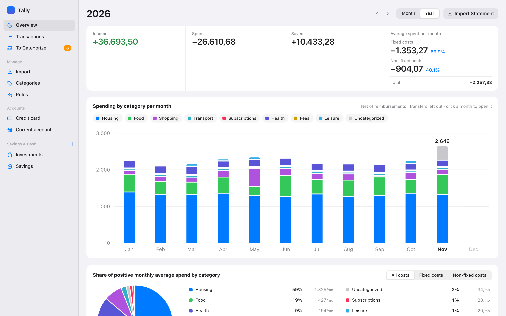
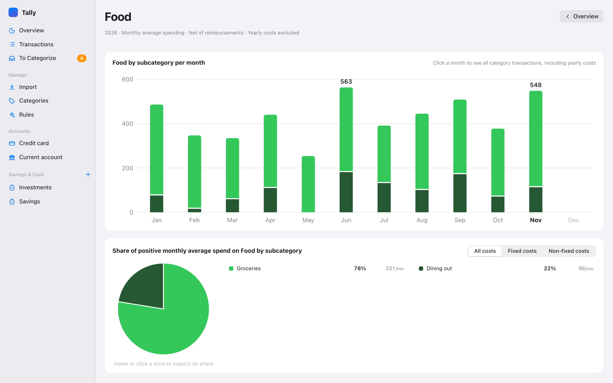

# Tally

A personal finance tracker for your bank and credit-card exports. Tally shows what things really
cost you: the credit-card bill counts once (the purchases are the spending, not the bill), and money
friends pay back by Tikkie comes off the expense it pays back.

<picture>
  <source media="(prefers-color-scheme: dark)" srcset="docs/screenshots/overview-dark.png">
  
</picture>

<sub>All screenshots show made-up demo data from <a href="web/demo"><code>web/demo</code></a>.</sub>

## What it does

### See where your money goes

The **year view** stacks each month's spending by category. Click a category to break it down by
subcategory, or turn categories on and off to compare the smaller ones. The **month view** shows
where the money went, how each category compares with the month before, and what was moved to
savings or investments instead of spent.

<table>
  <tr>
    <td width="50%"></td>
    <td width="50%"></td>
  </tr>
</table>

### Link what belongs together

- **Paid back.** Link the Tikkies for a dinner or a trip to what you paid. They take the expense's
  category, so the category shows your share. One payment can pay back several expenses, and you
  can add more payments later, from any month.
- **Transfers.** Paying the credit-card bill from your bank account is a transfer between your own
  accounts, not spending. Tally suggests these pairs for you.
- **Pots.** Savings or investment accounts you don't import. Money moved there is a transfer, and
  each pot has its own page.
- **Splits.** Divide one payment over several categories.

<table>
  <tr>
    <td width="50%"></td>
    <td width="50%"></td>
  </tr>
</table>

### Label once

- **Rules** label new transactions automatically: "counterparty contains *versmarkt* → Groceries",
  or "→ transfer to Savings". A rule can be limited to money in or out, one account, or an amount
  range. Before you save one, Tally shows every transaction it would cover. After you label
  something by hand, it offers to make a rule for it.
- **To Categorize** walks through what's left, transfer suggestions first, with keyboard shortcuts.

<table>
  <tr>
    <td width="50%"></td>
    <td width="50%"></td>
  </tr>
</table>

### Quick to work through


- **Import** an ING export (English CSV), an AMEX export (`Datum,Omschrijving,Bedrag`),
  an ABN AMRO Excel TXT export (one EUR account per `.TAB` file), or a Revolut English CSV statement
  containing completed EUR transactions.
  Overlapping exports don't create duplicates, and an import can be undone.
- **Categorize fast:** pick a category, press Enter, and the next transaction's picker opens.
- **Select several** transactions (⌘/Ctrl-click, Shift-click) to categorize, link or mark them
  as transfers at once.
- **Filter and search** by category, account or text, across all months.
- **Light and dark mode**, and a layout for your phone.

<br clear="right">

## How it's built

- **Backend:** Rust (tokio, tonic, SeaORM on Postgres). The API is defined in [`proto/finance`](proto/finance).
- **Frontend:** React + TypeScript in [`web/`](web), talking gRPC-web to the same server.
- **Design:** [`docs/data-model`](docs/data-model/index.html) and [`docs/mockups`](docs/mockups/index.html).

## Development

The dev shell (`direnv allow`, or `devenv shell`) provides Rust (through the mbx build cache), Node,
buf, sea-orm-cli and Postgres.

```sh
devenv up                       # local Postgres on 127.0.0.1:5432, database "finance"
cargo run -p tally-server       # API on 127.0.0.1:8080, runs migrations on start
cd web && npm install && npm run dev   # frontend on :5173, proxies the API
demo                            # made-up data on a throwaway database at 127.0.0.1:18080
DEMO_PASSKEY=1 demo             # the same with passkey sign-in, at localhost:18080
```

After changing the schema in `crates/migration`, run `generate-entities`. After changing a
`.proto` file, run `npm run generate` in `web/`. Both outputs are checked in. Conventions and
what every pull request needs are in [AGENTS.md](AGENTS.md).

## Tests

```sh
test-all                        # Rust tests on a throwaway Postgres
buf lint proto
cd web && npm run typecheck && npm test
```

## Running it

```sh
cd web && npm run build         # writes web/dist
cargo run --release -p tally-server
```

The `tally` binary serves the API and the built frontend on one port. Configuration comes from the
environment: `DATABASE_URL` (required), `LISTEN_ADDR` (default `127.0.0.1:8080`), `WEB_DIR`
(default `web/dist`) and `PASSKEY_FILE` (see below).

### Who can open it

Passkey sign-in is **off by default**. Tally then has no sign-in at all. The app opens straight
away, and every API call is answered, so whoever can reach the address can see and change
everything. That's fine while Tally listens only on `127.0.0.1`, which is the default. It's also
fine behind `tailscale serve` on a tailnet that has only your own devices. Turn the passkey on
before Tally is reachable by anyone else, for example on a tailnet you share.

| Tally is reachable | Passkey off (default) | Passkey on |
|---|---|---|
| Only on `127.0.0.1` (default) | Programs on that machine, no sign-in | Programs on that machine, after signing in |
| On a tailnet through `tailscale serve` | Every device on the tailnet, no sign-in | Every device can load the page; only your passkey signs in |

You can turn it on or off at any time; nothing in the database changes. Turning it off leaves the
passkey file unused, so turning it back on later brings back the same passkey.

### Passkey sign-in

Set `PASSKEY_FILE` to a path Tally can write, and every API call needs a session:

1. The first time you open Tally, it asks you to **create a passkey**. It's saved in your password
   manager (such as iCloud Keychain, which syncs it to your other devices), and its public key goes
   into `PASSKEY_FILE`. Only that passkey can sign in from then on.
2. Each device signs in with Face ID, Touch ID or a PIN and stays signed in for 30 days.
3. To start over (a lost passkey, or to sign every device out), delete the file. The next visit
   shows the setup screen again.

Whoever opens Tally first after deploying can claim it, so set it up straight away, on a network
only you are on. Passkeys need https (or `localhost`) and only work at the address they were made
on: open Tally at its final https address when you set it up.

### On NixOS

[`nix/module.nix`](nix/module.nix) runs Tally as a service with its own local Postgres database,
on `127.0.0.1:8080` by default. Import it from a pinned copy of this repo:

```nix
# configuration.nix
let
  tally = builtins.fetchTarball {
    url = "https://github.com/kalmjasper/tally/archive/<commit>.tar.gz";
    sha256 = "<hash>"; # nix-prefetch-url --unpack <url>
  };
in
{
  imports = [ "${tally}/nix/module.nix" ];
  services.tailscale.enable = true;
  services.tally = {
    enable = true;
    passkey.enable = true;         # passkey saved in /var/lib/tally/passkey.json
    tailscaleServe.enable = true;
  };
}
```

With `tailscaleServe.enable`, the module sets up `tailscale serve` itself. It adds a
`tally-tailscale-serve` service that points the tailnet's `https://<machine>.<tailnet>.ts.net` at
Tally on every boot, and removes that setting when you turn the option off. tailscaled gets the
certificate and renews it. You still do three things:

1. Set `services.tailscale.enable = true`. The module refuses to build without it.
2. Sign the machine in to your tailnet once (`sudo tailscale up`, or `services.tailscale.authKeyFile`).
3. In the Tailscale admin console under **DNS**, turn on MagicDNS and **HTTPS Certificates**.

To run `tailscale serve` yourself instead, leave `tailscaleServe` off and point it at
`http://127.0.0.1:8080`.

On a flake-based system, add `inputs.tally = { url = "github:kalmjasper/tally"; flake = false; };`
and import `"${inputs.tally}/nix/module.nix"`. `nix flake update tally` then pulls in new versions.
The package on its own is `pkgs.callPackage "${tally}/nix/package.nix" { }`, and
`nix-build nix/test.nix` boots a VM that checks the module works.

## License

Apache License 2.0. See [LICENSE](LICENSE).
